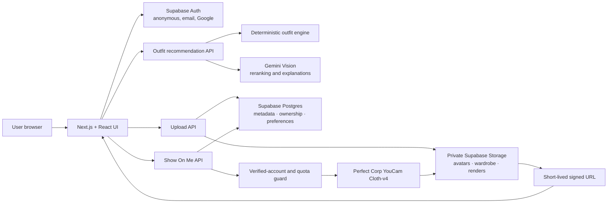

# TheLook

[](https://github.com/aposalik/TheLook/actions/workflows/ci.yml)

> **An AI wardrobe stylist that creates grounded outfit options from a user’s own clothes, explains the choice, and renders a selected look with YouCam virtual try-on.**

TheLook is a web application built for the **YouCam API Skin AI & eCommerce VTO Hackathon**. It separates inexpensive styling exploration from the explicit, credit-consuming virtual try-on action:

```text
Wardrobe → valid outfit construction → AI stylist explanation → user selects a look → Show On Me → virtual try-on
```

The project combines deterministic outfit rules, Gemini Vision, Perfect Corp YouCam Cloth-v4, Supabase, and a Next.js interface designed around private, user-owned wardrobes.

## Contents

- [What it does](#what-it-does)
- [Architecture](#architecture)
- [Guest and account model](#guest-and-account-model)
- [Quick start](#quick-start)
- [Configuration](#configuration)
- [How the AI workflow works](#how-the-ai-workflow-works)
- [Security and privacy](#security-and-privacy)
- [Verification](#verification)
- [Project structure](#project-structure)
- [Roadmap and current boundaries](#roadmap-and-current-boundaries)
- [Contributing](#contributing)

## What it does

### Wardrobe and styling

- Add personal garments from a device or a direct image URL.
- Remove backgrounds in the browser and classify garments with Gemini Vision when configured.
- Build five valid outfit candidates using slots, layers, color, formality, season, style, occasion, and diversity rules.
- Let Gemini rerank only those valid candidates; Gemini cannot introduce unowned products.
- Keep shoes and accessories as styling accents. They appear in recommendations but are not sent to the current Cloth-v4 render pipeline.
- Use the Style Assistant chat for weather-aware wardrobe suggestions powered by Gemini and Open-Meteo.

### Virtual try-on

- Save multiple full-body avatars.
- Render a dress in one full-body step or compose upper layers and chain a lower-body step.
- Cache repeated renders by avatar/look fingerprint.
- Keep YouCam rendering behind an explicit **Show On Me** action.
- Use `MOCK=1` for a credit-free development preview.

### Ownership and persistence

- Create an anonymous Supabase session for first-time visitors.
- Support permanent email and Google accounts.
- Keep guest and permanent accounts intentionally separate; guest data never transfers into an existing account.
- Store permanent-account files in private Supabase Storage and metadata in Supabase Postgres.
- Serve private files through authenticated checks or short-lived signed URLs.

## Architecture



### Responsibility boundaries

| Component | Responsibility |
| --- | --- |
| **Browser** | Interaction, client-side background removal, temporary guest data, outfit selection |
| **Next.js route handlers** | Verify the session, validate ownership, call external AI APIs, enforce paid-render controls |
| **Supabase Auth** | Anonymous and permanent user identities, sessions, OAuth/email authentication |
| **Supabase Postgres** | Metadata, ownership, preferences, saved looks, render jobs, and usage counters |
| **Supabase Storage** | Private avatar, wardrobe-cutout, and render image bytes |
| **Gemini Vision** | Garment analysis, candidate reranking, grounded explanations, and style chat |
| **YouCam Cloth-v4** | The final virtual try-on image only after explicit user intent |

### Private file layout

```text
avatars/{user_id}/{avatar_id}.jpg
wardrobe/{user_id}/{wardrobe_item_id}.png
renders/{user_id}/{render_job_id}.jpg
```

Every user-owned database row and Storage object is scoped to a Supabase user ID. Storage buckets are private.

## Guest and account model

TheLook deliberately avoids silent data merging.

```text
First visit
  → anonymous Supabase identity
  → guest wardrobe/session

Create account or sign in
  → clear warning: guest wardrobe will not transfer
  → permanent account identity
  → empty permanent wardrobe
  → user uploads permanent-account items again
```

This avoids unsafe ownership reassignment and ambiguous account-conflict logic. Guests can explore the wardrobe experience; verified permanent accounts are required for paid **Show On Me** rendering.

## Quick start

### Requirements

- Node.js 22+
- npm
- A Supabase project for Auth, private Storage, and Postgres persistence
- Perfect Corp YouCam credentials only for real virtual try-on
- Gemini API key only for Gemini-powered classification, reranking, and chat

### Install

```bash
git clone https://github.com/aposalik/TheLook.git
cd TheLook/web
npm ci
cp .env.local.example .env.local
npm run dev
```

Open <http://localhost:3000>.

> [!IMPORTANT]
> `.env.local` is ignored by Git. Keep all credentials in that local file or in protected deployment environment variables. Never paste credentials into an issue, pull request, terminal command, screenshot, or chat.

### Database migration

The versioned database migrations are in [`supabase/migrations`](supabase/migrations). Apply them to the intended Supabase project through the Supabase CLI or SQL Editor before testing persistent account data.

The foundation migration creates the user-owned tables, usage tables, Row-Level Security policies, and private buckets. The quota migration adds atomic render reservation functions.

## Configuration

Copy [`web/.env.local.example`](web/.env.local.example) to `web/.env.local` and add only the integrations you intend to use.

| Variable | Required | Visibility | Purpose |
| --- | --- | --- | --- |
| `NEXT_PUBLIC_SUPABASE_URL` | Yes | Browser-safe | Hosted Supabase project URL |
| `NEXT_PUBLIC_SUPABASE_PUBLISHABLE_KEY` | Yes | Browser-safe | Supabase publishable key; RLS still protects data |
| `SUPABASE_SERVICE_ROLE_KEY` | For server-side Storage/quota work | Server only | Private Storage writes, signed URLs, and trusted server operations |
| `RATE_LIMIT_HASH_SECRET` | For real quota enforcement | Server only | HMAC secret for hashing the trusted client IP before aggregation |
| `PERFECTCORP_KEY` | For real try-on | Server only | YouCam Cloth-v4 bearer credential |
| `GEMINI_API_KEY` | Optional | Server only | Gemini Vision and Style Assistant integration |
| `GEMINI_MODEL` | Optional | Server only | Defaults to `gemini-2.5-flash` when Gemini is configured |
| `NEXT_PUBLIC_TURNSTILE_SITE_KEY` | Optional | Browser-safe | Cloudflare Turnstile site key |
| `MOCK=1` | Recommended for development | Server only | Avoids a real YouCam render and returns a preview instead |

### Supabase Auth setup

1. Add the Supabase URL and publishable key locally.
2. Enable Anonymous and Email providers in Supabase Auth.
3. Require email confirmation for permanent email accounts.
4. Configure Google OAuth if Google sign-in is enabled.
5. Add `http://localhost:3000/auth/callback` and deployed callback URLs to Supabase Auth URL configuration.
6. Optionally configure Turnstile in both the application and Supabase Auth CAPTCHA settings.

## How the AI workflow works

### 1. Wardrobe ingestion

```text
Image file or direct URL
  → normalized browser image
  → client-side background removal
  → Gemini garment metadata when available
  → private Storage upload for a permanent account
  → Postgres metadata row
```

The application uses a deterministic fallback when Gemini is unavailable. Direct image URLs are routed through a guarded fetch endpoint with protocol, DNS/private-address, redirect, MIME, size, and timeout checks.

### 2. Recommendation

```text
Selected anchors + wardrobe metadata
  → hard slot/layer constraints
  → deterministic compatibility scoring
  → five valid candidates
  → Gemini visual rerank of those candidates
  → three diverse, grounded recommendations
```

Catalog pairs use the offline compatibility matrix. User-uploaded garment combinations use structured metadata compatibility. The deterministic engine always remains the source of truth for valid item IDs.

### 3. Virtual try-on

```text
Verified account + selected avatar + selected look
  → ownership checks
  → cache / in-flight / quota checks
  → YouCam File API upload
  → Cloth-v4 render task(s)
  → private render Storage upload
  → signed result URL
```

- Dresses use one `full_body` render.
- Upper layers may be combined into one reference image.
- Bottoms may be applied in a subsequent `lower_body` render.
- Shoes and accessories are recommendations only in the current render pipeline.

### 4. Style Assistant

The Style Assistant uses Gemini plus Open-Meteo weather data to suggest outfits from the user’s wardrobe. It sends garment metadata, not the user’s avatar/photo, to the assistant workflow. The server rejects unknown item IDs and re-applies outfit slot rules before presenting a suggested look.

## Security and privacy

### Access control

- User-owned Postgres tables use Row-Level Security.
- Private Storage object paths begin with the owning user ID.
- Route handlers derive ownership from the verified Supabase session; they never trust a client-supplied user ID.
- Signed URLs are created only after server-side ownership checks.
- The Supabase service-role key is server-only and bypasses RLS; use is deliberately limited to trusted server code.

### Paid-render controls

For real YouCam renders, the application has a layered design:

```text
verified permanent account
+ per-user daily quota
+ global daily / total-credit budget
+ duplicate-render fingerprint cache
+ in-flight render lock
+ HMAC-hashed IP aggregate
+ optional Turnstile and edge-rate controls
```

Raw IP addresses are not persisted by the quota helper. Cache hits do not create a new YouCam request.

### Data boundaries

- Guest data is browser-local until the user deliberately starts a separate permanent account.
- Permanent-account avatars, wardrobe cutouts, and renders are intended for private Supabase Storage.
- Real try-on inputs are sent to Perfect Corp to perform Cloth-v4 processing.
- External API credentials remain server-side.

## Verification

From `web/`:

```bash
npm run lint
npx tsc --noEmit
npm run build
```

GitHub Actions runs lint, typecheck, and production build for pushes and pull requests targeting `main`.

For development without YouCam credit consumption:

```dotenv
MOCK=1
```

## Project structure

```text
web/
├── app/
│   ├── api/                 # Route handlers: wardrobe, avatar, looks, chat, recommendation, try-on
│   ├── auth/                # Supabase OAuth/email callback
│   ├── components/          # Fitting room, wardrobe, lookbook, account and chat UI
│   └── proxy.ts             # Supabase session refresh
├── lib/
│   ├── recommend.ts         # Deterministic outfit construction and scoring
│   ├── gemini.ts            # Gemini server client
│   ├── youcam.ts            # Perfect Corp / Cloth-v4 client
│   ├── storage.ts           # Private Supabase Storage helpers
│   ├── db.ts                # Postgres persistence helpers
│   └── quota.ts             # Render quota reservation and completion helpers
├── data/                    # Runtime catalog and compatibility matrix
└── public/                  # Static catalog/reference assets and UI audio

supabase/
├── migrations/              # Versioned schema and quota migrations
└── tests/database/          # Database/RLS test definitions

_experiments/
└── catalog_pipeline.py      # Offline catalog, cutout, embedding, and compatibility pipeline
```

## Roadmap and current boundaries

The detailed build contract lives in [`PRODUCTION-ARCHITECTURE.md`](PRODUCTION-ARCHITECTURE.md). It defines the progression from schema/RLS through auth, Storage, database persistence, credit protection, deployment, operations, and final submission assets.

Current implementation notes:

- Supabase Free is suitable for development and an early demo, but its database, Storage, egress, and inactivity limits must be monitored.
- Local Docker-based Supabase testing is optional; hosted Supabase migration and manual security verification are supported.
- Some production flows require manual verification with real Supabase credentials and, where desired, real YouCam/Gemini credentials.
- Checkout is intentionally a mock experience.
- A repository license file is not currently included.

## Contributing

Use the protected-branch workflow:

```text
issue → feature branch → pull request → review → squash merge
```

Run the verification commands before opening a pull request. Use `MOCK=1` unless a deliberate real YouCam test is required.

See [`CONTRIBUTING.md`](CONTRIBUTING.md) for the collaboration workflow.

## Hackathon

- **Event:** YouCam API Skin AI & eCommerce VTO Hackathon
- **API:** Perfect Corp YouCam AI Clothes Virtual Try-On (Cloth-v4)
- **Submission materials:** screenshots, demo video, and Devpost copy are produced after the hosted flow is frozen.
