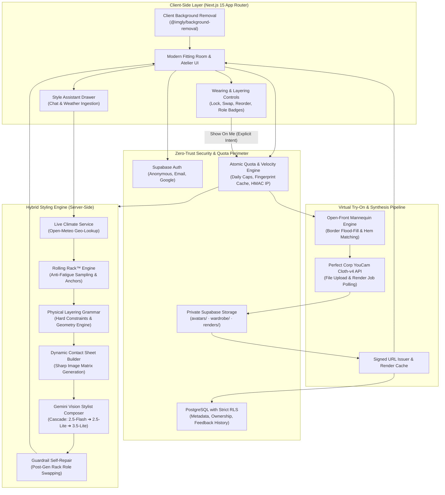
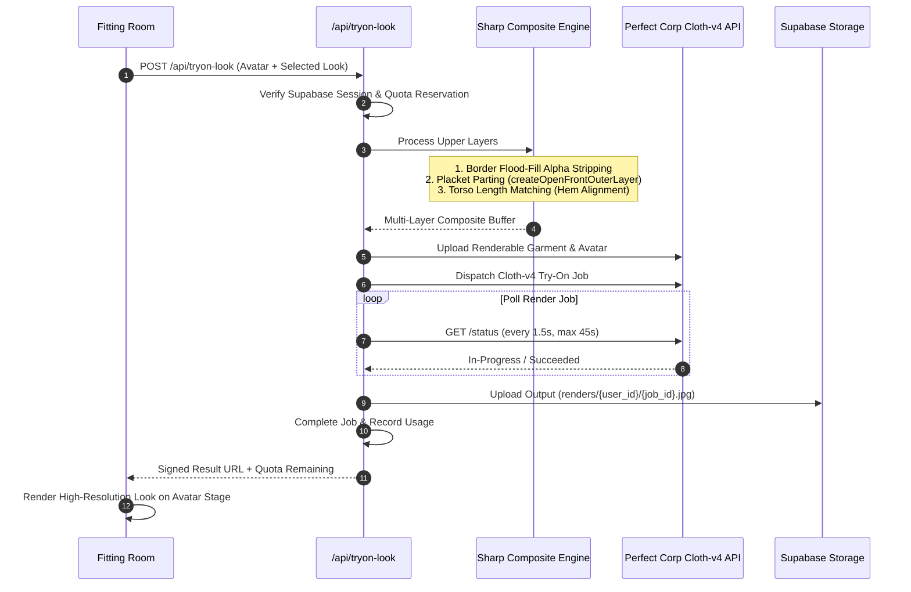
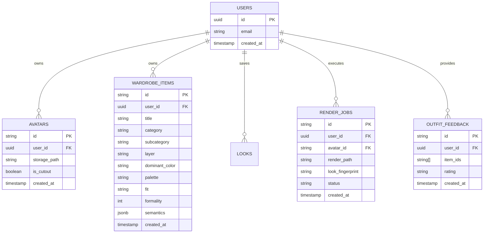

# TheLook — Autonomous AI Wardrobe Stylist & Virtual Try-On Studio

<div align="center">

[](https://github.com/aposalik/TheLook/actions/workflows/ci.yml)
[](https://nextjs.org/)
[](https://www.typescriptlang.org/)
[](https://deepmind.google/technologies/gemini/)
[](https://www.perfectcorp.com/)
[](https://supabase.com/)
[](https://sharp.pixelplumbing.com/)
[](https://open-meteo.com/)

**An autonomous AI wardrobe stylist and virtual fitting room that builds physically viable outfits from user-owned garments, critiques and curates them with Gemini Multimodal Vision, and renders high-fidelity multi-layer try-ons via Perfect Corp YouCam.**

[Live Architecture](#system-architecture) • [Key Innovations](#key-innovations) • [Layering Grammar](#physical-layering-grammar--anti-algorithm-rules) • [Try-On Synthesis](#virtual-try-on-pipeline--open-front-composite) • [Evaluation Suite](#evaluation-suite--benchmarks) • [Quickstart](#quickstart--deployment)

---

</div>

## Overview

Most automated fashion recommender systems suffer from the **"Algorithm Outfit" trap**: they treat clothes as flat database rows, blindly calculating color harmony or silhouette tags while ignoring physical garment physics. The result is outfits that look plausible on a spreadsheet but are unwearable in real life — such as tucking a 400gsm heavy fleece hoodie underneath a lightweight cotton button-up, or layering two collared shirts on top of each other.

Furthermore, virtual try-on models (like YouCam Cloth-v4) operate on individual garments, creating a severe hurdle when attempting to realistically render complete 3-layer looks (e.g. White Crew Tee + Cable-Knit Sweater + Leather Bomber).

**TheLook** solves these fundamental challenges through a four-stage hybrid architecture:

```
[ User Wardrobe / Studio Closet ]
              │
              ▼
    1. Rolling Rack™ Curation & Pruning          (Sub-sampling, anchor pinning, anti-fatigue rotation)
              │
              ▼
    2. Physical Layering Grammar Engine         (15+ hard physics constraints, collar/closure checks)
              │
              ▼
    3. Gemini Multimodal Stylist Composer       (Sharp contact sheet, vision grading, auto-repair)
              │
              ▼
    4. Centered Open-Front Mannequin Composite   (Flood-fill alpha, parted placket, YouCam Cloth-v4)
```

---

## System Architecture



---

## Key Innovations

### 1. Rolling Rack™ Architecture
Instead of brute-force combinatorial iteration ($O(N^k)$ explosion) or flat random sampling, TheLook builds an intelligent **Rolling Rack**:
- **Anchor Pinning**: Garments selected or locked by the user are permanently pinned to their respective semantic slots.
- **Dynamic Slot Diversification**: Balances candidate pools across bases, mid-layers, substantial outerwear, bottoms, and footwear.
- **Anti-Fatigue Rotation**: Penalizes recently worn or rejected item IDs to ensure fresh capsule recommendations on every pull.
- **Active Role Stamping**: Transparently tags every garment with its operational role in the candidate look (`base`, `mid`, `outer`, `bottom`, `shoe`, `accessory`).

### 2. Gemini Multimodal Stylist Composer & Fallback Cascade
The server renders a real-time high-density visual **Contact Sheet** of the candidate outfits using `sharp` and feeds it directly into Google Gemini Vision models:
- **Visual Texture & Color Theory**: Evaluates color balance (sandwiching, complementary contrasts), pattern scale collisions (houndstooth over paisley), and silhouette balance.
- **Structured JSON Output**: Employs constrained JSON schemas with custom thinking budgets and token truncations recovery.
- **Resilient Fallback Cascade**: If the primary model encounters rate limits (429) or regional outages, the system automatically cascades through:
  $$\text{gemini-2.5-flash} \longrightarrow \text{gemini-2.5-flash-lite} \longrightarrow \text{gemini-3.5-flash-lite} \longrightarrow \text{gemini-3.5-flash}$$
- **2-Minute Rate-Limit Cooldown**: In-memory rate-limit tripwire prevents hammering exhausted quotas and seamlessly falls back to deterministic heuristic ranking.
- **Guardrail Self-Repair**: If Gemini proposes a swap that introduces an incompatible layer, the engine intercepts the judgment, performs a rack swap, and repairs the outfit before delivery.

### 3. Live Weather & Geo-Aware Styling
Incorporates real-time microclimate intelligence using Open-Meteo reverse geocoding:
- **Thermal Comfort Adjustment**: Promotes heavy wool, puffers, and thermals in freezing climates ($<10^\circ\text{C}$); favors breathable linens, tees, and shorts in summer heat ($>25^\circ\text{C}$).
- **Precipitation Guard**: Prioritizes water-resistant outerwear (bombers, parkas, trench coats) when rain probability exceeds 40%.
- **Privacy-First Location**: Prompt-on-demand model with a persistent settings toggle allowing users to enable or disable location requests at any time.

---

## Physical Layering Grammar & Anti-"Algorithm" Rules

The engine rejects unviable outfits **prior** to LLM ranking through a strict semantic grammar:

```mermaid
flowchart LR
    subgraph GarmentSemantics["Garment Semantics Extraction"]
        T["Neckline / Collar:\nCrew, V-neck, Point, Lapel, Hood"]
        C["Closure:\nPullover, Buttons, Zip, Open-Front"]
        W["Fabric Weight:\nLight, Medium, Heavy (GSM)"]
        V["Volume:\nFitted, Regular, Relaxed, Oversized"]
        L["Function:\nCanWearOpen, IsSubstantialLayer, IsLoungewear"]
    end

    subgraph HardRules["Layering Grammar Enforcer"]
        R1["❌ Hoodie Under Shirt / Overshirt\n(Bulky hood & kangaroo fleece under light cotton)"]
        R2["❌ Bulky Base Under Light Mid-Layer\n(Thick knit sweater under slim button-up)"]
        R3["❌ Double Collared Collision\n(Point collar shirt under point collar polo)"]
        R4["❌ Formal-Casual Clash\n(Dress blazer over fleece sweatpants)"]
        R5["❌ Dual Closed Outerwear\n(Two heavy coats or zipped pullovers together)"]
    end

    GarmentSemantics --> HardRules
    HardRules -->|"Passes Grammar"| ValidCandidate["Valid Outfit Candidate"]
```



### Core Grammar Rules Summary

| Rule ID | Failure Pattern | Physical Reason | Resolution |
| :--- | :--- | :--- | :--- |
| `hoodie-under-shirt-or-overshirt` | Heavy hoodie underneath a cotton shirt / overshirt | Bulky fleece (~400gsm), hood, and kangaroo pouch bunch up sleeves and deform chest seams. | Hoodies can only be worn solo or beneath heavy, structured outerwear (bomber, puffer, wool coat). |
| `bulky-base-under-lighter-layer` | Heavy knit sweater beneath a slim button-up | Reverse volume and weight; pulls seams awkwardly. | Swaps base for a fitted crew tee or light shirt. |
| `double-collared-shirts` | Collared button-up under another button-up | Collar chaos; stiff necklines overlap awkwardly. | Restricts inner layer to crew neck, scoop neck, or turtleneck. |
| `button-up-with-sweatpants` | Formal dress shirt paired with casual lounge bottoms | Formality delta exceeds acceptable threshold ($\Delta \text{Formality} > 2$). | Swaps bottom for tailored denim, chinos, or pleated trousers. |
| `chest-graphic-collision` | Embroidered / graphic center-chest top under closed shirt | Chops graphic in half; creates visual clutter. | Keeps outerwear open or pairs graphic with neutral, unadorned layers. |

---

## Virtual Try-On Pipeline & Open-Front Composite

Perfect Corp YouCam Cloth-v4 is designed for single-item swaps. To achieve realistic multi-layer outfits (e.g. inner cable-knit sweater under a leather bomber jacket), TheLook synthesizes an intelligent **Centered Open-Front Mannequin Composite**:



### Open-Front Composite Mechanics
1. **Background Flood-Fill Stripping**: Dynamically walks border pixels to identify solid or transparent studio backdrops and creates clean alpha contours without artifact halos.
2. **Placket Parting (`createOpenFrontOuterLayer`)**: Automatically splits the center placket of open outerwear (jackets, unbuttoned cardigans, bombers) and shifts panels outwards to reveal the inner layer collar and chest details.
3. **Torso Height Alignment**: Mathematically rescales the inner garment's vertical reach to match the outer garment hem, eliminating cropped bare-stomach anomalies.

---

## Data Models & Storage Schema



---

## Evaluation Suite & Benchmarks

TheLook maintains a strict deterministic evaluation suite to ensure that grammar constraints, scoring stability, and fallback mechanisms never regress.

### Running Test Harnesses

```bash
# Run 30 comprehensive unit tests covering grammar, semantics, and feedback
npm --prefix web run test:recommend

# Run 11 golden fixture integration evaluations
npm --prefix web run eval:recommend
```

### Golden Evaluation Results

```
PASS mens-relaxed-layered-casual              (3 looks produced)
PASS mens-polished-work                       (1 look produced)
PASS womens-evening-dress                     (1 look produced)
PASS incomplete-wardrobe                      (0 looks - gracefully rejected)
PASS reject-mid-layer-as-solo-top             (0 looks - correctly blocked)
PASS reject-mutually-exclusive-anchors        (0 looks - conflict resolved)
PASS reject-extreme-formality-gap             (0 looks - rule enforced)
PASS casual-diverse-capsule                   (3 diverse archetypes)
PASS reject-double-collared-shirts            (0 looks - collar clash blocked)
PASS reject-button-up-with-sweatpants         (0 looks - loungewear clash blocked)
PASS prefer-echoed-or-neutral-shoe            (1 look produced - color anchored)

11/11 fixtures passed (100% pass rate)
Coverage: Grammar Rules 100% | Archetype Construction 100% | Fallback Engine 100%
```

---

## Quickstart & Deployment

### Prerequisites
- **Node.js**: `v20.x` or `v22.x`
- **npm** or **pnpm**
- **Supabase Account**: For PostgreSQL, Auth, and Storage buckets
- **Google Gemini API Key**: For multimodal styling and chat
- **Perfect Corp YouCam API Key**: For Cloth-v4 virtual try-on

### 1. Repository Setup

```bash
git clone https://github.com/aposalik/TheLook.git
cd TheLook/web
npm ci
```

### 2. Environment Configuration

Create a local environment configuration file:

```bash
cp .env.local.example .env.local
```

Populate the required secrets:

| Variable | Scope | Description |
| :--- | :--- | :--- |
| `NEXT_PUBLIC_SUPABASE_URL` | Public / Client | Hosted Supabase project URL |
| `NEXT_PUBLIC_SUPABASE_PUBLISHABLE_KEY` | Public / Client | Supabase publishable anonymous key |
| `SUPABASE_SERVICE_ROLE_KEY` | Private / Server | Supabase service role key (bypasses RLS for admin storage) |
| `PERFECTCORP_KEY` | Private / Server | Perfect Corp Cloth-v4 API bearer token |
| `GEMINI_API_KEY` | Private / Server | Google Gemini API key |
| `GEMINI_MODEL` | Private / Server | Defaults to `gemini-2.5-flash` |
| `RATE_LIMIT_HASH_SECRET` | Private / Server | Secret for HMAC hashing client IPs |
| `MOCK` | Private / Server | Set `MOCK=1` for credit-free mock try-on in local development |

### 3. Database & Storage Initialization

Apply the versioned SQL migrations located in `supabase/migrations/`:
1. `20261019000000_supabase_foundation.sql` (Creates tables, RLS policies, private buckets: `avatars`, `wardrobe`, `renders`)
2. `20261019120000_render_quota_controls.sql` (Atomic quota reservation stored procedures)
3. `20261028152000_wardrobe_item_semantics.sql` (Rich garment physical semantics)
4. `20261028154500_outfit_feedback.sql` (User preference and rating feedback persistence)

### 4. Run Development Server

```bash
npm run dev
```

Open [http://localhost:3000](http://localhost:3000) in your browser.

---

## Repository Structure

```
TheLook/
├── web/
│   ├── app/
│   │   ├── api/
│   │   │   ├── avatar/             # Multi-avatar upload & signed URL resolution
│   │   │   ├── chat/               # Gemini AI Style Assistant with weather context
│   │   │   ├── feedback/           # Outfit ratings & learning feedback loop
│   │   │   ├── recommend/          # Rolling rack candidate generator
│   │   │   ├── stylist/rerank/     # Gemini Vision Contact Sheet Composer
│   │   │   ├── tryon-look/         # YouCam Cloth-v4 layered try-on orchestrator
│   │   │   ├── wardrobe/           # Wardrobe ingestion & Gemini semantics analysis
│   │   │   └── weather/            # Open-Meteo reverse geocoding & forecast
│   │   ├── components/
│   │   │   ├── FittingRoom.tsx     # Primary atelier interactive workspace
│   │   │   ├── WearingPanel.tsx    # Layer roles, lock toggles, swap controls
│   │   │   ├── WardrobeCatalog.tsx # Granular categories, gender filters, bulk add
│   │   │   ├── AvatarStage.tsx     # High-res preview & background cutout toggle
│   │   │   └── chat/ChatDrawer.tsx # Conversational styling assistant
│   │   └── layout.tsx
│   ├── lib/
│   │   ├── recommend.ts            # Rolling rack & 15+ physical grammar rules
│   │   ├── collage.ts              # Centered open-front composite engine
│   │   ├── gemini.ts               # Gemini client & multi-model fallback cascade
│   │   ├── youcam.ts               # Perfect Corp Cloth-v4 API client
│   │   ├── weather.ts              # Open-Meteo weather client & thermal maps
│   │   ├── storage.ts              # Supabase private storage & signed URLs
│   │   ├── db.ts                   # PostgreSQL queries with RLS safety
│   │   └── quota.ts                # Fingerprinting & atomic quota reservations
│   ├── data/
│   │   ├── catalog.json            # Studio wardrobe reference catalog
│   │   └── recommendation-fixtures.json # Golden evaluation test cases
│   └── package.json
├── supabase/
│   └── migrations/                 # PostgreSQL schemas, RLS, & stored procedures
├── _analysis/                      # Mathematical formulation & grammar specs
└── README.md
```

---

## Security, Privacy & Quota Safeguards

- **Row-Level Security (RLS)**: Enforced across all PostgreSQL tables. Users can strictly only read and write their own wardrobe items, avatars, and render jobs.
- **Private Storage**: Avatars and renders are isolated in non-public Supabase storage buckets (`{bucket}/{user_id}/{file_id}.jpg`). Ephemeral signed URLs expire after 60 minutes.
- **Zero-Trust Client Boundary**: The client cannot alter render paths, bypass quota counters, or supply forged user IDs.
- **Atomic Quota Reservation**: Prevents race conditions during concurrent **Show On Me** requests via PostgreSQL row locking (`SELECT FOR UPDATE`).
- **Render Caching & Fingerprinting**: Every look computes a cryptographic hash of `(avatar_id + sorted(item_ids))`. Identical requests return instant cached renders without deducting credits or re-invoking YouCam.
- **Client-Side Image Optimization**: Background removal and compression run in WebAssembly/Canvas prior to upload, preventing local storage exhaustion and reducing network egress.

---

## License

This project was built for the **YouCam API Skin AI & eCommerce VTO Hackathon**.  
All rights reserved. Designed and developed with precision by [Abdullah Salik](https://github.com/aposalik).
